

# Awesome Claude Motions

**1,111 night-blue motion graphics, drawn entirely in code by Claude, each with a full prompt.**

   

[English](#en) · [ไทย](#th) · [简体中文](#zh) · [Full list / รายชื่อทั้งหมด / 完整列表](#list)

## Examples · ตัวอย่าง · 示例

20 of the 1,111 motions (previews, actual clips are 1920×1080 · 10 s) · ตัวอย่าง 20 ท่าจากทั้งหมด 1,111 ท่า · 1,111 个动效中的 20 个示例

<table>
<tr><td align="center" width="25%">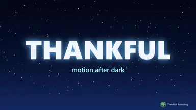 <b>0001</b> · Spring Pop Title Kinetic Type</td><td align="center" width="25%">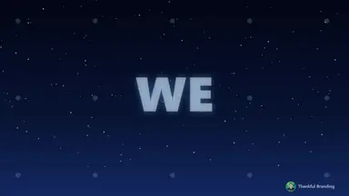 <b>0544</b> · Camera Chase Words Kinetic Type</td><td align="center" width="25%"> <b>0555</b> · Breaking News Stinger UI & Product</td><td align="center" width="25%">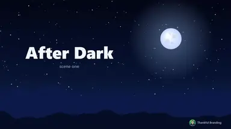 <b>0390</b> · Liquid Drip Transition Transitions</td></tr>
<tr><td align="center" width="25%"> <b>0180</b> · Glass Shatter Transitions</td><td align="center" width="25%">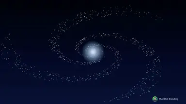 <b>0046</b> · Galaxy Vortex Particles & Space</td><td align="center" width="25%">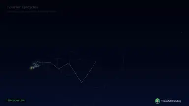 <b>0592</b> · Fourier Epicycle Draw Light & Shader</td><td align="center" width="25%">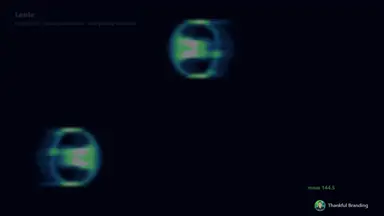 <b>0579</b> · Lenia Creatures Shapes</td></tr>
<tr><td align="center" width="25%">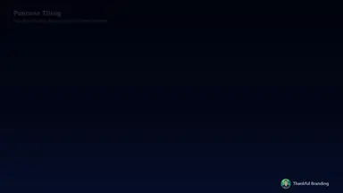 <b>0598</b> · Penrose Tiling Assemble Shapes</td><td align="center" width="25%">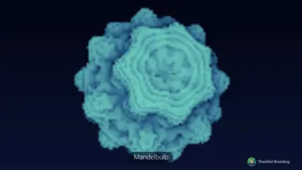 <b>0489</b> · Mandelbulb Raymarch 3D & Camera</td><td align="center" width="25%">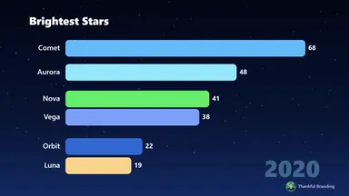 <b>0076</b> · Bar Chart Race Data</td><td align="center" width="25%"> <b>0635</b> · Bento Grid Assemble UI & Product</td></tr>
<tr><td align="center" width="25%">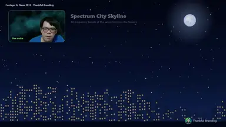 <b>0512</b> · Spectrum City Skyline Audio Reactive</td><td align="center" width="25%"> <b>0530</b> · Text Behind Host Footage Tracking</td><td align="center" width="25%">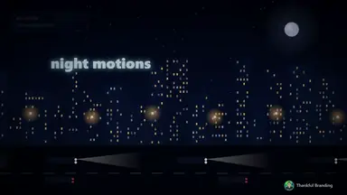 <b>0653</b> · Film Halation Bloom Post-process</td><td align="center" width="25%">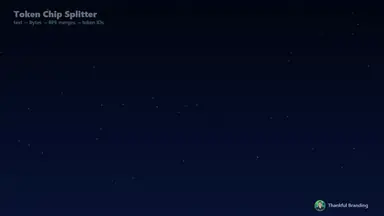 <b>0835</b> · Token Chip Splitter Kinetic Type</td></tr>
<tr><td align="center" width="25%"> <b>0984</b> · Spell Circle Cast Light & Shader</td><td align="center" width="25%"> <b>0890</b> · Thai Tone Contour Ladder Kinetic Type</td><td align="center" width="25%">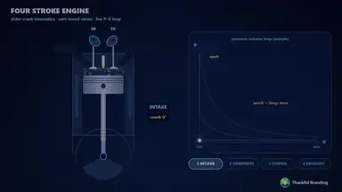 <b>1022</b> · Four Stroke Engine Cycle Shapes</td><td align="center" width="25%">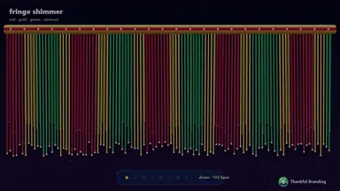 <b>1111</b> · Lion Dance Fringe Shimmer Particles & Space</td></tr>
</table>

---

## English

### What this is

**Claude Motions** is a library of 1,111 short motion graphics made by [Thankful Branding](#credits). Each one is a 10-second, 1920×1080, 30 fps clip in a night-sky blue style. Every frame is drawn by JavaScript canvas code that Claude wrote. No After Effects, no plugins, no AI image or video generators and no stock footage were used.

This repository holds **[Claude Motions Prompts.html](Claude%20Motions%20Prompts.html)**, a single offline HTML file with a card for every motion.

### What each card contains

- **Animated preview** of the motion (embedded WebP, no internet needed)
- **Name, number and category**
- **Full prompt**: the look, a second-by-second timeline, how it moves, how it ends, and where the brand sits
- **Prompt tips**: what to write so an AI gets this motion right
- **Reference source** for motions inspired by a technique or look found online

The page also has a **search box** (works in all three languages) and **category filters**.

> **Three languages:** switch between **ไทย · English · 简体中文** at the top right of the page. Every summary, full prompt and prompt tip is available in all three, and the page remembers your choice. Motion names stay in English. Opening the file with `?lang=en` or `?lang=zh` at the end of the address picks a language directly.

### How to open it

1. Click **[Claude Motions Prompts.html](Claude%20Motions%20Prompts.html)** above.
2. GitHub can't preview a file this large (≈133 MB). Click **Download raw file** (the ⬇ button on the right).
3. Open the downloaded file in Chrome, Edge, Firefox or Safari. It works offline and needs no install. The first load takes a few seconds.

The file is stored with Git LFS. If you clone the repo, run `git lfs install` first (or `git lfs pull` afterwards) to get the real file and not a small pointer.

### Categories

| Category | Motions |
|---|---|
| Kinetic Type | 132 |
| Shapes | 172 |
| Particles & Space | 95 |
| Light & Shader | 128 |
| Post-process | 28 |
| Transitions | 67 |
| Data | 141 |
| 3D & Camera | 91 |
| UI & Product | 209 |
| Audio Reactive | 20 |
| Speech Captions | 11 |
| Footage Tracking | 17 |
| **Total** | **1,111** |

### How they were made

- Built in a small canvas engine (960×540 drawn at 2× → 1920×1080), rendered frame by frame in headless Chrome and encoded with ffmpeg.
- Each motion is a pure function of time, so every render comes out the same.
- Clips in **Audio Reactive**, **Speech Captions** and **Footage Tracking** that use video or voice take them from the creator's own show, *AI News* (EP13, Thankful Branding). The source is credited inside those clips.
- Numbers shown in charts and dashboards are **sample data**. No real brands, platform logos or celebrities appear. Religious, sacred and royal imagery is avoided.

---

## ไทย

### นี่คืออะไร

**Claude Motions** คือคลัง Motion Graphic 1,111 ท่า โดย [Thankful Branding](#credits) แต่ละท่าเป็นคลิปยาว 10 วินาที ขนาด 1920×1080 ที่ 30 fps โทนสีน้ำเงินท้องฟ้ากลางคืน ทุกเฟรมวาดด้วยโค้ด JavaScript canvas ที่ Claude เขียนเองทั้งหมด ไม่ใช้ After Effects ไม่ใช้ปลั๊กอิน ไม่ใช้ AI สร้างภาพหรือวิดีโอ และไม่ใช้ฟุตเทจสต็อก

ใน repo นี้มีไฟล์ **[Claude Motions Prompts.html](Claude%20Motions%20Prompts.html)** เป็นไฟล์ HTML ไฟล์เดียว เปิดดูแบบออฟไลน์ได้ มีการ์ดครบทุกท่า

### ในการ์ดแต่ละใบมีอะไรบ้าง

- **ภาพตัวอย่างเคลื่อนไหว** ของท่านั้น (ฝังไว้ในไฟล์ ไม่ต้องต่อเน็ต)
- **ชื่อท่า เลขท่า และหมวด**
- **Prompt เต็ม** บอกหน้าตา ไทม์ไลน์ทีละช่วงวินาที วิธีเคลื่อนไหว ตอนจบ และตำแหน่งแบรนด์
- **เทคนิคการ Prompt** ควรเขียนอะไรให้ AI ทำท่านี้ออกมาได้ตรง
- **แหล่งอ้างอิง** สำหรับท่าที่ได้แรงบันดาลใจจากเทคนิคหรือหน้าตาที่ค้นเจอ

ในหน้ามี **ช่องค้นหา** (พิมพ์ได้ทั้ง 3 ภาษา) และ **ปุ่มกรองตามหมวด**

> **รองรับ 3 ภาษา** กดสลับ **ไทย · English · 简体中文** ได้ที่มุมขวาบนของหน้า คำอธิบาย Prompt เต็ม และเทคนิคการ Prompt มีครบทั้ง 3 ภาษา หน้าเว็บจะจำภาษาที่เลือกไว้ ส่วนชื่อท่าเป็นภาษาอังกฤษเหมือนเดิม

### วิธีเปิดดู

1. กดที่ไฟล์ **[Claude Motions Prompts.html](Claude%20Motions%20Prompts.html)** ด้านบน
2. ไฟล์ใหญ่ประมาณ 133 MB GitHub จึงแสดงตัวอย่างไม่ได้ ให้กด **Download raw file** (ปุ่ม ⬇ ด้านขวา)
3. เปิดไฟล์ที่ดาวน์โหลดด้วย Chrome, Edge, Firefox หรือ Safari ใช้ได้แบบออฟไลน์ ไม่ต้องติดตั้งอะไร ครั้งแรกอาจใช้เวลาโหลดสักครู่

ไฟล์นี้เก็บด้วย Git LFS ถ้าจะ clone ให้รัน `git lfs install` ก่อน (หรือ `git lfs pull` ทีหลัง) จะได้ไฟล์จริง ไม่ใช่แค่ไฟล์ตัวชี้ขนาดเล็ก

### หมวดทั้งหมด

| หมวด | จำนวนท่า |
|---|---|
| ตัวอักษรเคลื่อนไหว · Kinetic Type | 132 |
| รูปทรงและลวดลาย · Shapes | 172 |
| อนุภาคและอวกาศ · Particles & Space | 95 |
| แสงและเชดเดอร์ · Light & Shader | 128 |
| เอฟเฟกต์ภาพ (Post-process) · Post-process | 28 |
| ทรานซิชัน · Transitions | 67 |
| ข้อมูลและกราฟ · Data | 141 |
| 3 มิติและกล้อง · 3D & Camera | 91 |
| UI และโปรดักต์ · UI & Product | 209 |
| ขยับตามเสียง · Audio Reactive | 20 |
| คำบรรยายจากเสียงพูด · Speech Captions | 11 |
| แทร็กฟุตเทจ · Footage Tracking | 17 |
| **รวม** | **1,111** |

### สร้างขึ้นมาอย่างไร

- สร้างด้วยเอนจิน canvas ขนาดเล็ก (วาดที่ 960×540 ขยาย 2 เท่าเป็น 1920×1080) เรนเดอร์ทีละเฟรมด้วย Chrome แบบ headless แล้วเข้ารหัสวิดีโอด้วย ffmpeg
- ทุกท่าเป็นฟังก์ชันของเวลาล้วน เรนเดอร์กี่ครั้งก็ได้ผลเหมือนเดิม
- คลิปในหมวด **ขยับตามเสียง**, **คำบรรยายจากเสียงพูด** และ **แทร็กฟุตเทจ** ที่ใช้ภาพหรือเสียงจริง นำมาจากรายการ *AI News* (EP13, Thankful Branding) ของผู้สร้างเอง และใส่เครดิตแหล่งที่มาไว้ในคลิป
- ตัวเลขในกราฟและแดชบอร์ดเป็น **ข้อมูลตัวอย่าง** ไม่มีแบรนด์จริง โลโก้แพลตฟอร์ม หรือคนดัง และไม่ใช้ภาพทางศาสนา สิ่งศักดิ์สิทธิ์ หรือสัญลักษณ์ราชวงศ์

---

## 简体中文

### 这是什么

**Claude Motions** 是由 [Thankful Branding](#credits) 制作的 1,111 个动态图形（Motion Graphics）合集。每个都是 10 秒、1920×1080、30 fps 的短片，采用夜空蓝风格。每一帧都由 Claude 编写的 JavaScript Canvas 代码绘制。全程没有使用 After Effects、插件、AI 生图或生视频工具，也没有使用素材库视频。

本仓库包含 **[Claude Motions Prompts.html](Claude%20Motions%20Prompts.html)**：一个可离线打开的单文件 HTML，每个动效都有一张卡片。

### 每张卡片包含

- **动态预览**（以 WebP 内嵌在文件中，无需联网）
- **名称、编号与分类**
- **完整提示词（Prompt）**：画面外观、逐秒时间轴、运动方式、结尾方式以及品牌位置
- **提示词技巧**：怎样写才能让 AI 准确做出这个动效
- **参考来源**：灵感来自网上某种技术或风格的动效会注明出处

页面还提供 **搜索框**（三种语言均可搜索）以及 **分类筛选**。

> **支持三种语言：** 在页面右上角切换 **ไทย · English · 简体中文**。每张卡片的简介、完整提示词和提示词技巧都有三种语言版本，页面会记住你的选择。动效名称保持英文。在文件地址末尾加上 `?lang=zh` 也可以直接打开中文版。

### 如何打开

1. 点击上方的 **[Claude Motions Prompts.html](Claude%20Motions%20Prompts.html)**。
2. 文件约 133 MB，GitHub 无法预览。请点击右侧的 **Download raw file**（⬇ 按钮）下载。
3. 用 Chrome、Edge、Firefox 或 Safari 打开下载的文件。可离线使用，无需安装。首次加载需要几秒钟。

该文件使用 Git LFS 存储。如果要 clone 仓库，请先运行 `git lfs install`（或之后运行 `git lfs pull`），才能拿到真正的文件，而不是一个很小的指针文件。

### 分类

| 分类 | 数量 |
|---|---|
| 动态文字 · Kinetic Type | 132 |
| 几何图形 · Shapes | 172 |
| 粒子与太空 · Particles & Space | 95 |
| 光效与着色器 · Light & Shader | 128 |
| 后期特效 · Post-process | 28 |
| 转场 · Transitions | 67 |
| 数据可视化 · Data | 141 |
| 3D 与镜头 · 3D & Camera | 91 |
| UI 与产品 · UI & Product | 209 |
| 音频响应 · Audio Reactive | 20 |
| 语音字幕 · Speech Captions | 11 |
| 素材追踪 · Footage Tracking | 17 |
| **合计** | **1,111** |

### 制作方式

- 使用一个小型 Canvas 引擎（以 960×540 绘制并放大 2 倍到 1920×1080），在无头 Chrome 中逐帧渲染，再用 ffmpeg 编码。
- 每个动效都是关于时间的纯函数，每次渲染结果完全一致。
- **音频响应**、**语音字幕**、**素材追踪** 分类中使用真实画面或声音的片段，均取自作者本人的节目 *AI News*（EP13，Thankful Branding），并在片中注明来源。
- 图表和仪表盘中的数字均为 **示例数据**。不含真实品牌、平台标志或名人，也避免使用宗教、神圣或王室相关图像。

---

## Full list · รายชื่อทั้งหมด · 完整列表

1,111 motions, numbered as in the HTML file. Click a category to expand. 
ทั้งหมด 1,111 ท่า เลขท่าตรงกับในไฟล์ HTML กดที่หมวดเพื่อดูรายชื่อ 
共 1,111 个动效，编号与 HTML 文件一致。点击分类即可展开。

<b>Kinetic Type</b> · ตัวอักษรเคลื่อนไหว · 动态文字 (132)

- `0001` Spring Pop Title
- `0002` Stagger Letters Rise
- `0003` Typewriter Cursor
- `0004` Word Carousel Swap
- `0005` Blur In Text
- `0006` Mask Wipe Reveal
- `0007` Split Line Reveal
- `0008` Kinetic Scale Stack
- `0009` Neon Flicker Sign
- `0010` Text On Path
- `0011` Counting Number
- `0012` Scramble Decode
- `0013` Outline To Fill
- `0014` 3D Flip Letters
- `0015` Signature Write On
- `0101` Headline Slam
- `0102` Char Slam Explode
- `0103` Tracking In
- `0104` Top Down Letters
- `0105` Per Word Rise
- `0106` Per Word Crossfade
- `0107` Line By Line Slide
- `0108` Text Shimmer
- `0109` Variable Weight Flex
- `0110` Strikethrough Replace
- `0111` Marker Highlight
- `0112` Caption Pill Karaoke
- `0113` Streaming Text
- `0114` Wordmark Tiles
- `0151` Gradient Fill Caption
- `0152` Emoji Pop Caption
- `0153` Parallax Text Layers
- `0154` Difference Blend Text
- `0155` Texture Mask Text
- `0156` Stitched Text Draw
- `0157` Gooey Text Morph
- `0158` Kinetic Center Build
- `0159` Typed Prompt Submit
- `0160` Sketch Annotations
- `0161` Titlecard Calm
- `0162` Number Pop Stats
- `0201` Caption Highlight Box
- `0202` Editorial Emphasis
- `0203` Clip Wipe Caption
- `0204` Blur Out Up
- `0205` Text Match Cut
- `0206` Caret Swap Edit
- `0207` Stagger Lattice
- `0208` Whiteboard Ink
- `0209` Word Cloud Pop
- `0210` Ticker Takeover
- `0254` LT Kicker Name
- `0272` Handwritten Title Write
- `0273` Hand Drawn Frame
- `0274` Handwritten Path Text
- `0278` Prism Title
- `0284` Magnetic Letters
- `0297` Neon Glow Caption
- `0298` Caption Camera Follow
- `0299` CTA Lockup
- `0300` Logo Brand Close
- `0319` Caption Weight Shift
- `0320` Squiggle Underline
- `0321` Letter Flip Swap
- `0322` Emphasis Type Pop
- `0323` Stroke Trace Fill
- `0324` Ornament Separator
- `0325` Drift Hold Title
- `0326` ASCII Trail Reveal
- `0351` Wave Text Ripple
- `0352` Split Half Text
- `0353` Mirror Text Reflection
- `0354` Fill Water Text
- `0355` Long Shadow Text
- `0356` Outline Echo Text
- `0357` Vertical Text Roll
- `0358` Words Falling Pile
- `0359` Spinning Word Dial
- `0360` Fold Text Reveal
- `0443` Elastic Stretch Text
- `0444` Bouncy Word Jump
- `0445` Gradient Text Flow
- `0446` Glitch Text Swap
- `0447` Chalk Text Write
- `0448` Kerning Squeeze
- `0456` Canopy Part Title
- `0457` Cursor Glow Text Reveal
- `0458` Scan Band Wordmark
- `0481` Hand Drawn Speech Bubble
- `0506` Text Distortion Wobble
- `0539` Saul Bass Cutout Titles
- `0540` Scratched Jitter Titles
- `0541` Macro Letter Glide
- `0542` Perspective Crawl Text
- `0543` End Credits Roll
- `0544` Camera Chase Words
- `0545` Spinning Newspaper Headline
- `0546` Ransom Note Type
- `0547` Inflated Puffy Type
- `0548` Melting Type Drip
- `0549` Anagram Letter Shuffle
- `0550` Redacted Document Reveal
- `0551` Manga Focus Lines
- `0552` Rubber Stamp Impression
- `0564` Dot Matrix Destination Sign
- `0565` Calligram Shape Text
- `0566` Text Reflow Resize
- `0567` Domino Letter Topple
- `0568` Rapid Word Flash
- `0569` Sticker Peel Reveal
- `0570` Magazine Cover Build
- `0571` Inline Image Headline
- `0572` Swiss Grid Poster
- `0573` Stencil Spray Title
- `0574` Morse Code Decode
- `0700` True Focus Brackets
- `0719` Grunge Splatter Opener
- `0728` Sumi-e Brush Title
- `0752` Knit Sweater Type
- `0835` Token Chip Splitter
- `0852` Speculative Draft Verify
- `0867` LZ77 Sliding Window
- `0888` Thai Consonant Stroke Card
- `0889` Thai Vowel Orbit
- `0890` Thai Tone Contour Ladder
- `0891` Phonics Blend Slide
- `0913` Ivy Creep Over Title
- `0942` Snow Pile Accumulation
- `0970` Y2K Chrome Wordmark
- `0973` Constructivist Diagonal Type
- `0994` Alien Glyph Decipher
- `1066` POV Native Text Template

<b>Shapes</b> · รูปทรงและลวดลาย · 几何图形 (172)

- `0016` Spring Card Pop
- `0017` Stagger Dot Wave
- `0018` Gooey Metaball
- `0019` Morph Circle Square
- `0020` Polygon Morph
- `0021` Elastic Bounce Ball
- `0022` Pendulum Wave
- `0023` Orbit Rings
- `0024` Loading Arc Spinner
- `0025` Ripple Pulse
- `0026` Grid Flip Tiles
- `0027` Line Burst
- `0028` Spiral Dots
- `0029` Infinity Path Draw
- `0030` Breathing Blob
- `0031` Motion Blur Dash
- `0421` Spirograph Draw
- `0422` Circle Packing Grow
- `0423` Truchet Tiles Flip
- `0424` Maze Draw Solve
- `0425` L-System Tree Grow
- `0426` Concentric Squares Spin
- `0427` Hexagon Pulse Grid
- `0428` Bezier Ribbon Dance
- `0429` Paper Planes Flight
- `0430` Bubbles Rise
- `0431` Hourglass Sand
- `0432` Clock Hands Night
- `0461` Pendulum Swing Content
- `0462` Extended Keyframe
- `0463` Facet Morph
- `0464` Soft Blob Touch
- `0480` Flat Character Walk
- `0490` Newton Cradle Swing
- `0491` Cloth Flag
- `0492` Soft Body Jelly
- `0494` SPH Water Drops
- `0495` Verlet Rope Swing
- `0503` Rubber Hose Character Rig
- `0575` Wolfram Rule Cascade
- `0577` Langton Ant Highway
- `0578` Abelian Sandpile Bloom
- `0579` Lenia Creatures
- `0598` Penrose Tiling Assemble
- `0599` Apollonian Gasket Zoom
- `0600` Barnsley Fern Bloom
- `0601` Dragon Curve Unfold
- `0602` Hilbert Curve Fill
- `0604` Times Table Cardioid
- `0606` Hitomezashi Stitch Weave
- `0607` Voronoi Stipple Portrait
- `0610` Ink Drop Marbling
- `0611` Differential Growth Line
- `0612` Substrate City Cracks
- `0613` Sand Spline Drift
- `0631` Mind Map Branch Out
- `0682` Shadow Puppet Screen
- `0684` Phenakistoscope Loop
- `0698` Ball Pit Physics
- `0699` Magnet Needle Field
- `0702` Dot Orbit Grid
- `0704` Cake Slice Reveal
- `0705` Hydraulic Press Squish
- `0722` Lai Kranok Flame Growth
- `0723` Benjarong Trellis Fill
- `0724` Phuang Malai Threading
- `0725` Bo Sang Umbrella Bloom
- `0726` Wax Relief Carving
- `0727` Carved Fruit Rose
- `0731` Seigaiha Ripple Tiling
- `0732` Kintsugi Gold Seams
- `0735` Batik Wax Resist
- `0736` Shibori Indigo Unbind
- `0737` Kumiko Lattice Assemble
- `0738` Dancheong Band Paint
- `0739` Kolam Dot Loop
- `0740` Girih Compass Construction
- `0742` Papel Picado Flutter
- `0743` Bauhaus Shape Grid
- `0744` Memphis Squiggle Pop
- `0745` Art Deco Fan Frame
- `0746` Suprematist Drift
- `0747` Op Art Square Squeeze
- `0750` Tesserae Flow Mosaic
- `0751` Cross-Stitch Fill
- `0753` Loom Weave Draft
- `0776` Mitosis Cell Split
- `0777` Saltatory Neuron Signal
- `0778` Replication Fork Unzip
- `0779` Kinesin Cargo Walk
- `0790` Hex Snowflake Growth
- `0792` Seismic Shadow Zone
- `0821` Flour Sack Hop
- `0822` Ball Weight Comparison
- `0823` Onion Skin Ghost Frames
- `0824` Smear Frame Swipe
- `0825` Overlapping Action Tail
- `0826` Emotion Reaction Faces
- `0838` Dropout Neuron Flicker
- `0853` Mixture Of Experts Router
- `0855` ReAct Agent Loop
- `0857` Systolic Array Matmul
- `0859` DNS Resolver Relay
- `0861` Traceroute TTL Hops
- `0862` Diffie-Hellman Paint Mix
- `0865` Consistent Hashing Ring
- `0868` Git Branch Merge Graph
- `0869` CPU Cache Hit Miss
- `0870` QR Code Build Steps
- `0873` Pythagoras Rearrangement Proof
- `0875` Archimedes Polygon Squeeze
- `0881` Fraction Bar Equivalence
- `0882` Multiplication Array Flip
- `0886` Geometry Transform Ghosts
- `0887` Schelling Shape Shuffle
- `0911` Lotus Pond Bloom
- `0912` Phyllotaxis Petal Unfurl
- `0914` Mycelium Network Spread
- `0915` Foxfire Mushroom Ring
- `0920` Four Seasons Tree Cycle
- `0925` Butterfly Wing Generator
- `0926` Octopus Passing Cloud Skin
- `0927` Honeycomb Cell Building
- `0929` Orb Web Construction
- `0930` Chameleon Tongue Strike
- `0932` Venus Flytrap Snap
- `0935` Whale Breach Moonlight
- `0947` Glacier Calving Cliff
- `0949` Stalactite Drip Time-Lapse
- `0971` Art Nouveau Whiplash Frame
- `0972` Boogie Woogie Grid Traffic
- `0974` Celtic Knot Weave
- `0975` Guilloche Security Rosette
- `0976` Linocut Brayer Print
- `0977` Terrazzo Pour Grind
- `0978` Delft Tile Mirror Repeat
- `0979` Solarpunk Sun Tracking City
- `0981` Rosemaling Scroll Paint
- `0995` Robot Boot Sequence
- `1002` Solar Sail Unfurl
- `1005` Shock Diamond Plume
- `1008` Rover Rocker Bogie Drive
- `1022` Four Stroke Engine Cycle
- `1024` Gear Train Ratio Readout
- `1025` Planetary Gear Lock Modes
- `1026` Jansen Linkage Walker
- `1027` Geneva Drive Indexer
- `1028` Mechanism Plate Catalog
- `1029` Three Phase Rotating Field
- `1044` Escalator Step Chain Cutaway
- `1046` Canal Lock Lift
- `1047` Tunnel Boring Ring Build
- `1053` Water Treatment Floc Stages
- `1067` Googly Eyes Wobble
- `1068` Kawaii Blush Bunch
- `1069` Crayon Scribble Fill
- `1070` Split Pin Paper Puppet
- `1072` Alphabet Train Ride
- `1073` Counting Fruit Pop
- `1074` Paint By Number Fill
- `1075` Pop-It Fidget Board
- `1076` Marble Run Loop
- `1077` Rube Goldberg Chain
- `1078` Kinetic Sand Slicing
- `1079` Soap Curl Shaving
- `1080` Ball Sort Tubes
- `1081` Perfect Fit Drop
- `1082` Slime Stretch Snap
- `1083` Icing Piping Swirl
- `1084` Slinky Stair Walk
- `1087` Rotating Gate Pass Loop
- `1108` Children's Day Kites

<b>Particles & Space</b> · อนุภาคและอวกาศ · 粒子与太空 (95)

- `0032` Starfield Warp
- `0033` Twinkling Night Sky
- `0034` Shooting Stars
- `0035` Spiral Galaxy
- `0036` Constellation Connect
- `0037` Fireflies Drift
- `0038` Snowfall Night
- `0039` Particle Text Assemble
- `0040` Particle Explosion
- `0041` Moonrise
- `0042` Meteor Shower
- `0043` Nebula Clouds
- `0044` Orbiting Planets
- `0045` Comet Trail
- `0046` Galaxy Vortex
- `0433` Train Window Pass
- `0434` Firefly Jar
- `0435` Satellite Orbit Earth
- `0436` Candle Flicker
- `0437` Bioluminescent Waves
- `0438` Crystal Refraction
- `0439` Smoke Wisps
- `0440` Disco Ball Reflections
- `0441` Glitter Sparkle Field
- `0442` Mandala Bloom
- `0482` Boids Flocking
- `0484` Lorenz Attractor
- `0485` Clifford Attractor
- `0486` Physarum Slime
- `0507` Interactive Particles Repel
- `0576` Game Of Life Garden
- `0580` Ising Magnet Domains
- `0581` Particle Life Ecosystem
- `0582` Firefly Sync Kuramoto
- `0583` Double Pendulum Chaos
- `0585` Chladni Sand Figures
- `0590` Brachistochrone Race
- `0614` Bubble Chamber Tracks
- `0665` Star Trails Stack
- `0686` Anime Cel Explosion
- `0716` Procedural Serpent Trail
- `0721` Songkran Bowl Splash
- `0748` Pointillist Dab Build
- `0760` Graduation Cap Toss
- `0762` Lagrange Point Tadpoles
- `0763` Galaxy Collision Tidal Tails
- `0764` Kepler Equal Area Sweep
- `0765` Hohmann Transfer Burn
- `0766` Three Body Figure Eight
- `0770` Coronal Loop Eruption
- `0771` Magnetosphere Bow Shock
- `0773` Pulsar Lighthouse Beams
- `0774` Supernova Remnant Fingers
- `0775` Spring Neap Tide Bulge
- `0782` Blood Cell Stream
- `0783` Run Tumble Chemotaxis
- `0787` Lennard-Jones Melt Freeze
- `0791` Mantle Convection Plates
- `0827` Stadium Crowd Wave
- `0848` Embedding Vector Arithmetic
- `0854` RAG Vector Retrieval
- `0908` Gas Law Piston Box
- `0916` Meadow Wind Gust Waves
- `0917` Sakura Gust Drift
- `0918` Maple Samara Spin Fall
- `0919` Dandelion Seed Release
- `0922` Bait Ball Predator Strike
- `0923` Starling Murmuration Waves
- `0924` Migrating V Formation
- `0928` Ant Pheromone Foraging
- `0933` Coral Polyp Night Feed
- `0934` Hatchling Moon Crawl
- `0945` Strombolian Lava Bombs
- `0946` Geyser Eruption Cycle
- `0948` Dune Ripple Migration
- `0950` River Meander Oxbow
- `0997` Tractor Beam Lift
- `0999` Wormhole Two Skies
- `1000` Binary Merger Chirp
- `1001` Comet Dual Tails
- `1003` Rocket Staging Ascent
- `1004` Booster Hover Slam Landing
- `1006` Sky Crane Touchdown
- `1007` Lunar Dust Ballistic Spray
- `1009` Satellite Train Deploy
- `1012` Reentry Plasma Sheath
- `1015` Kessler Debris Cascade
- `1016` Kinetic Impactor Deflection
- `1017` Dyson Swarm Assembly
- `1023` Turbofan Airflow Cutaway
- `1052` Wind Farm Wake Streaks
- `1054` Lithium Ion Shuttle Cutaway
- `1064` Chat Emote Rain
- `1107` Heart Curve Particles
- `1111` Lion Dance Fringe Shimmer

<b>Light & Shader</b> · แสงและเชดเดอร์ · 光效与着色器 (128)

- `0047` Aurora Curtains
- `0048` Flowing Gradient
- `0049` Light Rays
- `0050` Glow Pulse Orb
- `0051` Bokeh Lights
- `0052` Liquid Glass Lens
- `0053` Chrome Orb
- `0054` Plasma Waves
- `0055` Caustic Water Light
- `0056` Lens Flare Sweep
- `0119` Voronoi Cells
- `0120` Worley Starlight
- `0121` Domain Warp Flow
- `0122` Sine Wave Layers
- `0123` Oscilloscope Trace
- `0124` Hypno Spiral
- `0125` Marble Flow
- `0126` Sunburst Rays
- `0127` Thin Film Bubble
- `0128` Hologram Projector
- `0129` Gravitational Lens
- `0170` Light Leak Overlay
- `0171` Film Grain Night
- `0172` Rack Focus
- `0173` Prism Dispersion
- `0174` Liquid Metal
- `0175` Frost Crystals
- `0176` Flow Field Strands
- `0177` Color Wheel Spin
- `0217` Moonlit Lake Reflection
- `0218` Wave Stripes
- `0219` Soft Plastic Shapes
- `0220` Holographic Foil Card
- `0221` Cosmic Orb
- `0222` Border Light Beam
- `0223` Light Sweep Pass
- `0224` Portal Ring
- `0225` Camcorder Viewfinder
- `0226` Chromatic Radial Split
- `0285` Swirl Gradient
- `0286` Ridged Burn Reveal
- `0287` Thermal Distortion
- `0288` Obsidian Glass
- `0289` Grade Split Reveal
- `0290` Beat Pulse Background
- `0327` Dynamic Warp Grid
- `0328` Vignette Breathe
- `0329` Segmentation Flood
- `0330` Particle Logo Reveal
- `0331` LCD Pixel Wall
- `0332` Rolling Night Fog
- `0333` Cinemagraph Loop
- `0371` Fireworks Night
- `0372` Lantern Release
- `0373` Rain On Window
- `0374` Lightning Strike
- `0375` Lighthouse Beam
- `0376` Jellyfish Glow
- `0377` Searchlight Premiere
- `0378` Laser Show Beams
- `0379` Moire Pattern
- `0380` Electric Arcs
- `0465` Gabor Noise
- `0466` Anamorphic Flare Field
- `0483` Reaction Diffusion
- `0487` Mandelbrot Zoom
- `0488` Julia Set Morph
- `0493` Fluid Smoke
- `0586` Double Slit Interference
- `0587` Doppler Wavefront Shift
- `0588` Electric Field Lines
- `0589` Karman Vortex Street
- `0591` Raycast Visibility Light
- `0592` Fourier Epicycle Draw
- `0594` Newton Fractal Basins
- `0595` Complex Domain Coloring
- `0596` Mobius Grid Transform
- `0597` Hyperbolic Disk Tiling
- `0608` Topographic Contour Lines
- `0694` AI Edge Glow
- `0701` Smoke Ring Halo
- `0712` Relight Point Light
- `0720` Krathong River Drift
- `0729` Ink Wash Mountains
- `0730` Ukiyo-e Wave Crash
- `0741` Fanous Lantern Shadows
- `0749` Stained Glass Backlight
- `0767` Black Hole Accretion Disk
- `0769` Solar Granulation Boil
- `0772` Eclipse Diamond Ring
- `0788` BZ Spiral Waves
- `0789` Ferrofluid Spike Crown
- `0794` Hurricane Eye Spiral
- `0795` Kelvin Helmholtz Billows
- `0796` Rainbow Raindrop Optics
- `0797` Snell's Window Underwater
- `0799` Gerstner Night Ocean
- `0800` Raymarched Lava Lamp
- `0831` Blueprint Draft Logo
- `0832` Moving Head Beam Fan
- `0833` Stage LED Panel Mapping
- `0909` Flame Test Spectrum
- `0921` Kelp Forest Surge Sway
- `0936` Moon Halo Moondogs
- `0937` City Light Pillars
- `0938` Noctilucent Cloud Ripples
- `0939` Mammatus Storm Underbelly
- `0940` Red Sprite Flash
- `0941` Rain Ripple Puddle
- `0943` Tornado Funnel Debris
- `0944` Haboob Dust Wall
- `0964` Marquee Bulb Chase Sign
- `0982` Hex Shield Impact Ripples
- `0983` Teleport Beam-In
- `0984` Spell Circle Cast
- `0985` Sword Slash Spark Arc
- `0986` Plasma Blade Ignition
- `0987` Elemental Fireball Volley
- `0988` Ice Spear Shatter
- `0989` Ground Slam Fissures
- `0990` Healing Aura Rise
- `0991` Cloak Shimmer Fade
- `0992` Plasma Globe Touch
- `0996` Laser Grid Breach
- `1104` Paparazzi Flash Wall
- `1105` Diya Row Lighting
- `1106` Jack-o'-Lantern Flicker
- `1110` Sparkler Year Writing

<b>Post-process</b> · เอฟเฟกต์ภาพ (Post-process) · 后期特效 (28)

- `0057` ASCII Render
- `0058` Bayer Dither
- `0059` Chromatic Glitch
- `0060` Scanline CRT
- `0061` Pixel Sort Streaks
- `0062` Halftone Dots
- `0063` Slit Scan Ribbon
- `0064` VHS Tracking
- `0065` Mosaic Pixelate Reveal
- `0066` Echo Trails
- `0467` Echo Smear
- `0469` Filmed Screen
- `0479` Vertical Fill Widescreen
- `0653` Film Halation Bloom
- `0655` Risograph Misregistration
- `0656` Xerox Zine Copy
- `0663` Night Vision Scope
- `0672` Engraving Hatch Shade
- `0680` Comic Panel Pop
- `0683` Scratch Film Animation
- `0691` Lens Dirt Bloom
- `0703` Fluted Glass Distortion
- `0709` Digicam Flash Date Stamp
- `0710` Photo Booth Strip
- `0713` Magic Eraser Heal
- `0714` JPEG Low Res Crunch
- `0804` Hit Stop Impact Freeze
- `0844` Convolution Kernel Slide

<b>Transitions</b> · ทรานซิชัน · 转场 (67)

- `0067` Circle Iris Wipe
- `0068` Diagonal Slice Wipe
- `0069` Venetian Blinds
- `0070` Clock Wipe
- `0071` Zoom Through Transition
- `0072` Whip Pan Blur
- `0073` Ink Bleed Reveal
- `0074` Shape Morph Transition
- `0075` Pixel Dissolve
- `0130` Curtain Reveal
- `0131` Torn Paper Rip
- `0132` Shutter Slam
- `0133` Flash Through White
- `0134` Falling Lines
- `0178` Cross Warp Morph
- `0179` Halftone Dissolve
- `0180` Glass Shatter
- `0181` Colorama Wipe
- `0182` Match Cut Morph
- `0227` Blur Crossfade
- `0228` Cover Slide
- `0229` Scale Card Swap
- `0230` Cube Rotate Transition
- `0231` Grid Cascade Wipe
- `0232` Fade Through Color
- `0233` Page Curl Turn
- `0234` Clone Wall Zoom
- `0291` Scribble Transition
- `0292` Ripple Warp Transition
- `0293` Light Leak Transition
- `0294` Mechanical Gate
- `0295` Crumble Blocks
- `0296` Freeze Frame Dressing
- `0334` Star Mask Reveal
- `0335` Shared Axis Y
- `0336` Physical Drop Exit
- `0337` Panel Slide Reveal
- `0338` Zoom Punch In
- `0339` Radial Slice Reveal
- `0340` Screen Swarm Transition
- `0381` Diamond Wipe
- `0382` Wave Wipe
- `0383` Spiral Wipe
- `0384` Checkerboard Wipe
- `0385` Bars Stagger Wipe
- `0386` Flip Card Transition
- `0387` Noise Dissolve
- `0388` Glitch Cut Transition
- `0389` Kaleidoscope Transition
- `0390` Liquid Drip Transition
- `0459` Paper Collage Reveal
- `0478` Beat Freeze Cut
- `0505` Displacement Hover Swap
- `0508` Noise Gooey Image Reveal
- `0559` Replay Logo Stinger
- `0560` Fisheye Bulge Transition
- `0561` Stretch Smear Transition
- `0562` Accordion Fold Transition
- `0563` Letter Portal Zoom
- `0654` Academy Leader Countdown
- `0658` Datamosh Bleed
- `0674` CRT Power Off
- `0675` Color Bars Signal Loss
- `0678` Slide Projector Carousel
- `0711` Pre-Hook Flash Rewind
- `0734` Jianzhi Cut And Unfold
- `0818` Screen Melt Transition

<b>Data</b> · ข้อมูลและกราฟ · 数据可视化 (141)

- `0076` Bar Chart Race
- `0077` Line Chart Draw
- `0078` Donut Chart Fill
- `0079` Progress Ring KPI
- `0080` Counter Money Burst
- `0081` Map Flight Arc
- `0082` Network Graph Pulse
- `0083` Timeline Steps
- `0084` Radar Sweep
- `0085` Area Wave Chart
- `0115` Slot Machine Roll
- `0116` Number Wheel
- `0117` Split Flap Board
- `0118` Heatmap Grid
- `0163` Decline Chart Recovery
- `0164` Chart Story Callouts
- `0165` Flowchart Build
- `0166` Hex Grid Map
- `0167` Progress Stat Bars
- `0168` Usage Gauge Arc
- `0169` AI Answer Rank
- `0211` Bubble Map Pulse
- `0212` Hub Flow Map
- `0213` Beat Timeline Track
- `0214` Week In Review Stats
- `0215` Specs List Reveal
- `0216` Checklist Card
- `0349` Arc Path Traveler
- `0350` Flatten Curve Chart
- `0361` Pie Chart Explode
- `0362` Funnel Chart
- `0363` Scatter Plot Bubbles
- `0364` Radar Chart Spider
- `0365` Gantt Bars
- `0366` Sankey Flow
- `0367` Treemap Split
- `0368` Waterfall Chart
- `0369` Leaderboard Climb
- `0370` Countdown Timer
- `0449` US Tile Choropleth
- `0450` World Globe Choropleth
- `0451` Region Choropleth
- `0452` Map Region Zoom Callout
- `0453` Plane Route Map
- `0473` Week In Merges
- `0496` Streamgraph Flow
- `0497` Horizon Chart
- `0498` Parallel Coordinates Sweep
- `0499` Candlestick Chart
- `0500` Bump Chart Rank Swap
- `0501` Chord Diagram Pulse
- `0502` Radial Partition Chart
- `0554` Parliament Hemicycle Seats
- `0584` Galton Board Bell
- `0593` Logistic Bifurcation Tree
- `0603` Ulam Prime Spiral
- `0605` Recaman Arc Sequence
- `0615` Waffle Chart Fill
- `0616` Gapminder Bubble Motion
- `0617` Beeswarm Settle
- `0618` Unit Dot Layout Morph
- `0619` Dumbbell Gap Chart
- `0620` Marimekko Build
- `0621` Population Pyramid Shift
- `0622` Nightingale Rose Chart
- `0623` Arc Diagram Links
- `0624` Edge Bundling Radial
- `0625` Collapsible Tree Expand
- `0626` Venn Overlap Merge
- `0627` Spiral Timeline Plot
- `0628` Sorting Bars Algorithm
- `0629` Exponential Doubling Dots
- `0644` Globe To Map Unroll
- `0645` Day Night Terminator
- `0646` Trips Layer Trails
- `0647` Isochrone Expand
- `0648` Dorling Cartogram Morph
- `0649` Spike Map Rise
- `0650` Route Elevation Profile
- `0652` Dot Density Map
- `0717` Instruction Manual Diagram
- `0756` Tactics Board Play
- `0757` Interval Rep Counter
- `0758` Weather Front Map
- `0768` Exoplanet Transit Dip
- `0786` Balmer Emission Lines
- `0836` Neural Net Forward Pass
- `0837` Backprop Error Ripple
- `0839` Decision Boundary Training
- `0840` Optimizer Marble Race
- `0841` Overfit Underfit Curves
- `0842` Decision Tree Split Grid
- `0843` K-Means Centroid Steps
- `0845` Attention Head Lines
- `0846` Causal Attention Matrix
- `0851` KV Cache Growth
- `0856` Scaling Law Log-Log
- `0858` Quantization Bit Crunch
- `0863` Hash Avalanche Grid
- `0864` Bloom Filter Bits
- `0866` Huffman Tree Merge
- `0872` A-Star Vs Dijkstra Race
- `0874` Unit Circle Sine Unwrap
- `0876` Riemann Rectangles Converge
- `0877` Secant To Tangent Limit
- `0878` Euler Identity Compounding
- `0879` Monty Hall Door Tally
- `0880` Law Of Large Numbers Flips
- `0883` Sieve Of Eratosthenes Grid
- `0898` Note Value Subdivision Tree
- `0900` Heart Rate Zone Climb
- `0901` Sleep Hypnogram Staircase
- `0902` Compound Interest Snowball
- `0903` Budget 50-30-20 Pour
- `0904` Inflation Shrinking Basket
- `0906` Maillard Browning Meter
- `0907` Titration Curve Indicator
- `0910` Free Throw Arc Window
- `1010` Orbit Ground Track Wave
- `1011` Docking Approach Corridor
- `1013` Aerobraking Orbit Shrink
- `1014` Gravity Assist Slingshot
- `1018` Space Elevator Climb
- `1019` Spin Station Coriolis
- `1020` PCB Autorouter Wavefront
- `1021` Half Adder Truth Table
- `1035` Truss Bridge Force Colors
- `1039` Marey Train Schedule Graph
- `1042` Ring Road Phantom Jam
- `1050` Grid Frequency Balance
- `1088` Pace Light Rail
- `1089` Photo Finish Slit Scan
- `1090` Record Pace Line Swim
- `1091` Golf Shot Tracer
- `1092` Tennis Serve Speed Trace
- `1093` Player Heatmap Pitch
- `1094` Sector Timing Tower
- `1095` Fight Round Scorecard
- `1096` Knockout Bracket Advance
- `1098` Breakaway Gap Clock
- `1099` Archery Pulse Target

<b>3D & Camera</b> · 3 มิติและกล้อง · 3D 与镜头 (91)

- `0086` Fibonacci Card Sphere
- `0087` Rotating Wireframe Cube
- `0088` Torus Knot Points
- `0089` Infinite Tunnel
- `0090` Perspective Grid Flyover
- `0091` Card Stack Carousel 3D
- `0092` Camera Shake Impact
- `0093` Parallax Mountains Night
- `0149` Three Orbiting Cards
- `0150` Perspective Marquee
- `0195` Exploded Stack
- `0196` Gallery Tunnel
- `0197` Product Turntable
- `0198` Extruded Logo
- `0199` Dolly Zoom Vertigo
- `0200` Cube Carousel
- `0245` Multi Device Splay
- `0246` Device Screen Dive
- `0247` Atom Nucleus Orbit
- `0248` Pull Back Reveal
- `0249` Pan Across Stations
- `0250` Depth Layer Push In
- `0260` Carousel Circle Ring
- `0261` Carousel Path Flow
- `0262` Text Circle Spin
- `0263` Vision Carousel
- `0341` Depth Card Stack
- `0342` Scan Gate Reveal
- `0343` Parallax Unzoom
- `0344` Wireframe Portal Title
- `0345` Glass Hero Panel
- `0346` Glass Shard Title
- `0347` Extruded Code Block
- `0348` Phone Device Spin
- `0391` Rotating Globe Dots
- `0392` Planet With Rings
- `0393` Isometric City Build
- `0394` Isometric Bar Chart
- `0395` DNA Helix
- `0396` Wave Terrain Mesh
- `0397` Book Page Flip
- `0398` Coin Flip 3D
- `0399` Dice Roll
- `0400` Cylinder Text Scroll
- `0454` iOS Liquid Glass iPhone
- `0455` macOS Liquid Glass MacBook
- `0468` Frost Camera Orbit
- `0489` Mandelbulb Raymarch
- `0630` Scale Zoom Compare
- `0632` Isometric Pipeline Flow
- `0659` Tilt Shift Miniature
- `0660` Tiny Planet Polar
- `0661` Droste Spiral Zoom
- `0664` Wigglegram Stereo
- `0666` Gaussian Splat Resolve
- `0668` Planar Screen Replace
- `0669` Projection Mapping Facade
- `0670` Cel Shaded Orb
- `0681` Paper Cut Diorama
- `0687` Bullet Time Orbit
- `0697` Hyperspeed Highway Lights
- `0706` Cloth Pull Unveil
- `0707` Collectible Figurine Box
- `0708` PS1 Vertex Wobble
- `0715` LiDAR Point Cloud Sweep
- `0733` Origami Crease Fold
- `0754` Floor Plan Build Up
- `0780` Protein Ribbon Fold
- `0784` Virus Capsid Assembly
- `0785` Hydrogen Orbital Cloud
- `0793` Global Wind Streamlines
- `0798` Volumetric Cloud Flythrough
- `0801` SDF Primitive Morph 3D
- `0847` Transformer Block Stack
- `0871` Bloch Sphere Qubit Gates
- `0884` Conic Section Slice
- `0885` Cube Net Unfold
- `0931` Seashell Coil Growth
- `0957` Packaging Dieline Fold
- `0961` Stylised House Orbit Flyover
- `0980` Isometric Icon Extrude Set
- `0998` Warp Bubble Spacetime
- `1032` Layer By Layer 3D Print
- `1034` Hidden Line CAD Modes
- `1036` FEA Mesh Stress Bloom
- `1037` Tower Crane Core Climb
- `1051` Solar Tracker Day Arc
- `1071` Toy Block Tower
- `1086` Rolling Cube Tessellation
- `1097` Podium Medal Ceremony
- `1109` Pop-Up Card Unfold

<b>UI & Product</b> · UI และโปรดักต์ · UI 与产品 (209)

- `0094` Modal Morph
- `0095` Cursor Click Demo
- `0096` Hand Drawn Boil
- `0097` Notification Drop In
- `0098` Chat Bubble Typing
- `0099` Search Bar Typing
- `0100` Logo Sting Thankful
- `0135` Audio Waveform
- `0136` Before After Wipe
- `0137` Settings Toggle Flow
- `0138` Star Rating Fill
- `0139` Tabs Slide Indicator
- `0140` Pull To Refresh
- `0141` Skeleton Reveal
- `0142` Onboarding Stepper
- `0143` Terminal Simulator
- `0144` Code Typing Editor
- `0145` Badge Pop
- `0146` Confetti Celebration
- `0147` Lower Third Clean Bar
- `0148` News Ticker
- `0183` Now Playing Card
- `0184` Testimonial Card
- `0185` Avatar Stack Proof
- `0186` Multiplayer Cursors
- `0187` Cursor Drag Drop
- `0188` Cursor Marquee Select
- `0189` Cursor Context Menu
- `0190` Browser Device Stage
- `0191` Sheet Spring Up
- `0192` Menu Icon Morph
- `0193` Signup Flow
- `0194` Telemetry HUD
- `0235` Social Post Card
- `0236` Follow Button Pop
- `0237` Comment Card Stack
- `0238` Code Diff Review
- `0239` Logo Wall Grid
- `0240` Swipe Rail Cards
- `0241` Spotlight Card Hover
- `0242` Agent Cursor Task
- `0243` Magnetic Button
- `0244` Touch Gesture Demo
- `0251` LT Accent Underline
- `0252` LT Bold Block
- `0253` LT Dark Card
- `0255` LT Mask Reveal
- `0256` LT Neon Border
- `0257` LT Side Rule
- `0258` LT Soft Pill
- `0259` LT Stack Bars
- `0264` Code Highlight Lines
- `0265` Code Morph
- `0266` Code Scroll Highlight
- `0267` Code Slice Hero
- `0268` Message Thread Reveal
- `0269` Forum Post Card
- `0270` Team Chat Notification
- `0271` Thread Message Stack
- `0275` Circle Pointer Callout
- `0276` Feather Highlight
- `0277` Screen Warp Zoom
- `0279` Cursor Glyph Trail
- `0280` Cursor Text Select
- `0281` Cursor Zoom Follow
- `0282` Oversized Cursor
- `0283` Dart Cursor
- `0301` Icon Morph Beat
- `0302` Icon Swap Rail
- `0303` Input Feedback States
- `0304` Toggle Flip Switch
- `0305` Rubber Band Bumper
- `0306` Velocity Throw Snap
- `0307` Spring Stack Shuffle
- `0308` State Chip Rail
- `0309` Sticky Header Swap
- `0310` System Banner Actions
- `0311` App Badge Lockup
- `0312` Trust Strip Logos
- `0313` Testimonial Proof Card
- `0314` Scroll Feed
- `0315` Screen Flow Carousel
- `0316` UI Focus Zoom
- `0317` Card Resize Expand
- `0318` Comparison Split
- `0401` Battery Charging
- `0402` Download Progress Circle
- `0403` Upload Cloud Sync
- `0404` Face Unlock Scan
- `0405` Fingerprint Scan
- `0406` Password Unlock Dots
- `0407` Weather Card Night
- `0408` Calendar Flip Date
- `0409` Pricing Table Reveal
- `0410` Feature Grid Icons
- `0411` Stopwatch Laps
- `0412` KPI Tiles Grid
- `0413` Vinyl Record Spin
- `0414` Music Visualizer Circular
- `0415` Map Pin Drop
- `0416` Loading Dots Bounce
- `0417` Film Strip Roll
- `0418` Polaroid Develop
- `0419` Photo Stack Drop
- `0420` Cassette Tape Play
- `0460` Code Shader Dissolve
- `0470` QR Camera Scan Gate
- `0471` Tracing Beam
- `0472` Vector Editor Pen Rig
- `0474` Notes App Typing
- `0475` Claude Exchange Reasoning
- `0476` Avatar Cloud Links
- `0477` Overwhelm Surround
- `0504` Interactive Mascot State Machine
- `0553` Score Bug Update
- `0555` Breaking News Stinger
- `0556` Live Bug Clock
- `0557` Versus Split Faceoff
- `0558` Multi-Box Split Screen
- `0609` Wave Function Collapse
- `0633` Dynamic Island Expand
- `0634` Add To Cart Fly
- `0635` Bento Grid Assemble
- `0636` Leader Line Hotspots
- `0637` Histogram Range Filter
- `0638` Spreadsheet Autofill Chart
- `0639` Node Workflow Wiring
- `0640` Genie Minimize
- `0641` Magic Move Slides
- `0642` Swipe Row Actions
- `0643` Predictive Back Shrink
- `0651` Ride ETA Tracker
- `0657` Teletext Page
- `0671` Diffusion Denoise Reveal
- `0676` Nixie Tube Counter
- `0677` Win95 Window Trail
- `0679` 8-Bit Title Screen
- `0692` Wavy Progress Squiggle
- `0693` Button Group Squish
- `0695` Progressive Blur Edge
- `0696` Dock Magnify Wave
- `0718` Frutiger Aero Gloss
- `0755` Recipe Bowl Steps
- `0759` Wax Seal Envelope Open
- `0761` Flash Sale Price Slash
- `0781` ECG Heartbeat Monitor
- `0802` Floating Damage Numbers
- `0803` Ghost Chip Health Bar
- `0805` Combo Meter Rank
- `0806` XP Bar Level Up
- `0807` Achievement Unlock Toast
- `0808` Loot Chest Rarity Burst
- `0809` Card Draw Fan Hand
- `0810` Ability Cooldown Wipe
- `0811` Coin Collect Fly HUD
- `0812` Prize Wheel Spin
- `0813` Radial Weapon Wheel
- `0814` Minimap Ping Fog
- `0815` Level Complete Star Tally
- `0816` Skill Tree Unlock
- `0817` RPG Dialogue Box
- `0819` Race Start Lights
- `0820` Boss Intro Title Card
- `0828` Loader Grid Showcase
- `0829` Icon State Quartet
- `0830` Liquid Wave Progress Orb
- `0849` Temperature Top-P Sampling
- `0850` Context Window Conveyor
- `0860` TCP Handshake Sequence
- `0899` Box Breathing Guide
- `0905` Eisenhower Matrix Sort
- `0951` Thermal Receipt Print
- `0952` Barcode Scan Checkout
- `0953` Event Ticket Tear Stub
- `0954` Boarding Pass Route Fold
- `0955` Loyalty Stamp Card Fill
- `0956` Scratch Card Reveal
- `0958` Unboxing Lid Lift
- `0959` Swing Tag Price Reveal
- `0960` Car Dashboard Cluster
- `0962` Editorial Lookbook Carousel
- `0963` Digital Menu Board Specials
- `0965` Brand Swatch Fan Deck
- `0966` Billboard Paste Up
- `0967` Neumorphic Soft Press Panel
- `0968` Claymorphism Squish Cards
- `0969` Neo-Brutalist Card Slam
- `1030` IK Arm Pick And Place
- `1031` SMT Pick And Place Line
- `1033` CNC Pocket Toolpath
- `1038` Octilinear Metro Map Draw
- `1040` Railway Block Signal Panel
- `1041` Signalized Intersection Phases
- `1043` Elevator LOOK Dispatch
- `1045` ATC Scope Data Blocks
- `1048` Container Crane Bay Plan
- `1049` Warehouse Pod Robot Grid
- `1055` Live Chat Stream Overlay
- `1056` Poll Sticker Results
- `1057` Emoji Slider Poll
- `1058` Story Progress Segments
- `1059` Tier List Drag Board
- `1060` This Or That Rounds
- `1061` Quiz Countdown Reveal
- `1062` Stream Donation Alert
- `1063` Stream Starting Soon
- `1065` Live Hearts Fountain
- `1085` Claw Machine Grab
- `1103` Venue Seat Map Pick

<b>Audio Reactive</b> · ขยับตามเสียง · 音频响应 (20)

- `0509` Voice Spectrogram Waterfall
- `0510` Broadcast Loudness Meter
- `0511` Voice Phase Portrait Scope
- `0512` Spectrum City Skyline
- `0513` Pitch Contour Ribbon
- `0514` Syllable Spark Bursts
- `0515` Spectrum Ridgeline Stack
- `0516` Talking Logo Bounce
- `0517` Speech Activity Timeline
- `0518` Audio Synced Punch Zoom
- `0834` Audio Kaleido Mirror Loop
- `0892` Piano Roll Step Sequencer
- `0893` Circle Of Fifths Progression
- `0894` Harmonic String Overtones
- `0895` Polyrhythm Clock Rings
- `0896` Guitar Fretboard Chord Shapes
- `0897` Major Minor Triad Keys
- `0993` Singing Tesla Coil
- `1100` Falling Notes Piano
- `1102` DJ Crossfader Blend

<b>Speech Captions</b> · คำบรรยายจากเสียงพูด · 语音字幕 (11)

- `0519` Live Dictation Typewriter
- `0520` Word Timeline Editor
- `0521` ASR Confidence Heat Captions
- `0522` Roll Up Broadcast Captions
- `0523` Speech Bubble Face Follow
- `0524` Keyword Pop Captions
- `0525` Loudness Weighted Captions
- `0526` Bilingual Dual Subtitles
- `0527` Transcript Panel Sync
- `0528` Speaking Pace Meter
- `1101` Bouncing Ball Lyrics

<b>Footage Tracking</b> · แทร็กฟุตเทจ · 素材追踪 (17)

- `0529` Face Track Name Tag
- `0530` Text Behind Host
- `0531` Night Sky Background Swap
- `0532` Face Mesh Wireframe
- `0533` Auto Reframe Vertical Follow
- `0534` Head Pose Axis Gizmo
- `0535` Lip And Blink Tracker
- `0536` Optical Flow Field Arrows
- `0537` Sticker Cutout Outline
- `0538` Face Spotlight Follow
- `0662` Thermal Ironbow Camera
- `0667` Depth Map 3D Photo
- `0673` Sobel Neon Edges
- `0685` Viseme Lip Sync Mascot
- `0688` Object Detection HUD
- `0689` Pose Skeleton Overlay
- `0690` Rotoscope Line Trace

---

## Credits · เครดิต · 致谢

- **Thankful Branding**: concept, art direction and the *AI News* footage used in footage clips · แนวคิด กำกับภาพ และฟุตเทจรายการ *AI News* · 创意、美术指导及 *AI News* 节目素材
- **Claude** (Anthropic): wrote all the motion code and prompts · เขียนโค้ดและ Prompt ทุกท่า · 编写全部动效代码与提示词
- Reference links in the cards point to the techniques or looks that inspired a motion. Every motion was rebuilt from scratch in code. · ลิงก์อ้างอิงในการ์ดคือเทคนิคหรือหน้าตาที่เป็นแรงบันดาลใจ ทุกท่าเขียนโค้ดขึ้นใหม่ทั้งหมด · 卡片中的参考链接指向启发该动效的技术或风格，所有动效均用代码从零重新实现。
